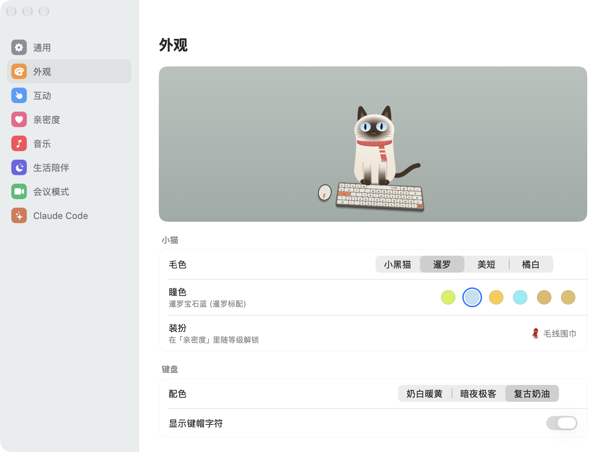

<p align="center">
  
</p>

<p align="center">
  <a href="README.md">简体中文</a> | <b>English</b>
</p>

# 🐱 CoolCat

A little cat that lives in the corner of your Mac desktop. It types along with you, puts on headphones and dances to the beat of your music, keeps an eye on every Claude Code session, stalks your cursor, munches fish treats — and every now and then pushes a small gift onto your desk.

> 🙏 **Credits**: CoolCat is a heavily modified fork of **[chanke17/KuroCat](https://github.com/chanke17/KuroCat)**.
> The full-state keyboard/mouse capture, 2.5D head tracking, four coat skins and the whole procedural CoreGraphics renderer come from the original project — huge thanks to [@chanke17](https://github.com/chanke17)!
> The original is MIT licensed; this repository stays MIT and keeps the original copyright notice in [LICENSE](LICENSE).

## ✨ Features

<p align="center">
  
</p>

- 🎧 **Dances to your music** — headphones on when a music player is playing, a vertical LED spectrum wall behind the cat, real beat tracking via a system audio tap (macOS 14.2+) aligned to your output latency, with tap-along calibration. Moves hit the beat and accent the downbeat ([more](#-hitting-the-beat)). Strong beats get head-bobs, calm songs get slow sways. While music plays it stays at the keyboard instead of wandering off.
- 🐾 **Roams your whole screen** — when you're idle it hops off the keyboard, gallops around like a cheetah, treats window tops like tables to jump between (climbing the frame when they're too high), chases your cursor, peeks from screen edges, curls up for naps, and runs back as soon as you type ([more](#-roaming)).
- 🤖 **Claude Code integration** — one-click hooks; a bubble shows *project · action · elapsed* per session, the cat waves when a session needs your approval — and if you're looking at another window, [holds up a sign](#-agent-sign) on it — and throws confetti when it is done.
- ⌨️ **Codex integration** — one-click hooks in `~/.codex/hooks.json` (trust them once via `/hooks` in Codex); Codex sessions share the bubble with Claude Code, marked by a blue spinner.
- 🎙 **Meeting mode** — headset when the mic is on, a "shh" when you type too loudly, a quick face wash before the camera turns on.
- 🌙 **Life companion** — nightcap late at night, morning coffee, sleepy on low battery, a water reminder after 50 minutes of work.
- 🪶 **Cursor play** — move the cursor slowly in front of the cat: it locks on, wiggles, and swats.
- 🐟 **Fish treats** — it holds the treat with both paws, nibbles, drops crumbs and burps (6 per day).
- 💞 **Bond levels** — every interaction builds affection (capped per day, never decays). Level up to unlock a bell collar, knitted scarf, bow and sunglasses; at higher levels it nuzzles your resting cursor and brings you a daily gift.
- 🐱 **13 cats** — the classic black, Siamese, shorthair and orange-white, plus orange tabby, Dragon Li, tuxedo, calico, British Blue, Scottish Fold, Ragdoll, white and golden.
- ⌨️ **Keyboard habits** and 😺 **idle animations**.

## 🐾 Roaming

<p align="center">
  
</p>

After 30 seconds without typing the cat leaves its keyboard and wanders around in a separate, fully click-through window:

- **Windows are tables** — it walks along window tops, crouches at the edge to aim and leaps across the gap to the next window. It can jump straight from its seat onto a nearby window and hops window to window on the way home. If a window moves it rides along; if the window closes it falls. A window needs some room above it to stand on (maximized windows pinned to the menu bar don't count).
- **Climbing** — real window tops are usually far higher than the cat can jump, so it walks to the frame and climbs up the side, then keeps hopping from the top (leaping onto the frame first if the window floats). *Settings → Interaction* shows live how many tops and frames are usable, and why there are none.
- **Cursor play** — wiggle the cursor slowly near a roaming cat: it stares, creeps closer, wiggles its butt and pounces, jumping for a cursor in mid-air; flick the cursor and it gallops after it. Catches earn bond points; after three pounces it takes a break.

<p align="center">
  
</p>

- **Peeking** — it hides past the bottom or side edge of the screen with only its head and two paws showing, clipped so it never spills onto another display.
- **Naps** — it curls up into a ball (high window tops are its favourite), breathing slowly with floating Zzz. The longer you're idle, the sleepier it gets.
- **Gallops like a cheetah** — running is a rotary gallop with a flexing spine and two flight phases per stride, head level and tail streaming back; every now and then it gets the zoomies and sprints off, braking with a crouch when it arrives.

<p align="center">
  
</p>

- **Comes back when needed** — typing sends it running home (a napping cat wakes with a start); it stays home during meetings or snacks, sticks to the keyboard dancing along while music plays (and gallops back if a song starts mid-walk), and comes back to remind you when Claude Code / Codex is waiting for your approval (or, if you're busy in another window, runs over and [holds up a sign](#-agent-sign)). After 10 minutes away from the keyboard it stops wandering and naps at its seat.

Turn roaming off under *Settings → Interaction*, where preview buttons trigger a walk, a peek, window hops or a nap on demand.

## 🙋 Agent sign

<p align="center">
  
</p>

When Claude Code or Codex stops to wait for your approval or reply while you're reading docs in another window and haven't typed for 3 seconds, the cat hops off the keyboard, runs to the frontmost window on its screen, sits on top of it and holds up a little sign reading "Claude Code needs approval" with the project name.

- **Getting there** — it jumps if it can, climbs the frame when the window is too tall, and sits on the screen edge right below the window when there's no room on top (a maximized window, say). Switch windows and it moves over to the new one.
- **Knows when to stop** — once you approve (or the agent stops waiting) it puts the sign down and strolls home; start typing on the way and it takes that as "I'm on it" and won't come back for that wait.
- **Stays polite** — it skips this during meetings but still goes while music plays (an agent waiting on you beats dancing). A napping cat wakes with a start first.
- It only reads window positions and sizes, never their contents, and needs no screen-recording permission.

Turn it off under *Settings → Interaction*; the *Sign preview* button pretends an agent is waiting for 20 seconds so you can see it right away.

## 🎚 Hitting the beat

<p align="center">
  
</p>

- **On the beat** — nods, bounces, head-bangs and raised paws arrive fast and stop dead on the beat, then ease back, instead of a constant sine sway. Measured through the actual dance springs, the peak lands right on the beat.
- **Feels the bar** — the downbeat is found from kick-drum weight per beat position; beat 1 is accented and moves change at bar starts.
- **Soft when unsure** — while the tempo is still being found it only does calm sways; once the tempo is stable it dances rhythmic moves, kept soft until the phase locks and snappy after. Songs in 6/8 or with a triplet feel no longer flip between 140, 93 and 70 BPM readings.
- **Tap-along calibration** — Bluetooth headphones often misreport their latency. In *Settings → Music → Beat calibration*, play a song with a clear kick and tap space on the beat 12 times; the offset is measured, applied and remembered per output device. A slider and a beat light let you fine-tune by eye.

## ⚙️ Settings window

A System Settings–style window (menu bar icon / right-click the cat → *Settings…*, or ⌘,) with a live-rendered preview cat.

<table>
  <tr>
    <td></td>
    <td></td>
  </tr>
</table>

## 📦 Build

macOS 11+ (real-time beat tracking needs macOS 14.2+).

```bash
./build.sh && open CoolCat.app
```

Requires *Input Monitoring*; *Screen & System Audio Recording* is optional and only used to analyze the music player's audio in memory. Package with `scripts/package-macos.sh`. The UI is in Simplified Chinese.

For beat diagnostics, launch with `open -a CoolCat --args --beat-log <file>` to log lock stats, tempo candidates and track titles every 5 seconds.

## 🔒 Privacy

- Keyboard and mouse events only drive animations and counters; nothing you type is recorded or uploaded.
- System audio is limited to the music player and analyzed in memory only.
- Agent hooks send only event names, tool names and the project folder name to the local cat — never prompts or code.
- Roaming reads window positions and sizes to find places to stand, never window contents, and needs no screen-recording permission.
- No network access, no update checks.

## 📄 License

[MIT License](LICENSE), keeping the original copyright notice of [chanke17/KuroCat](https://github.com/chanke17/KuroCat).
