<p align="center">
  
</p>

<p align="center">
  <a href="README.md">简体中文</a> | <b>English</b>
</p>

# 🐱 CoolCat

A little cat that lives in the corner of your Mac desktop. It types along with you, puts on headphones and dances to the beat of your music, keeps an eye on every Claude Code session, stalks your cursor, munches fish treats — and every now and then pushes a small gift onto your desk.

> 🙏 **Credits**: CoolCat is a heavily modified fork of **[chanke17/KuroCat](https://github.com/chanke17/KuroCat)**.
> The full-state keyboard/mouse capture, 2.5D head tracking, four coat skins and the whole procedural CoreGraphics renderer come from the original project — huge thanks to [@chanke17](https://github.com/chanke17)!
> The original is MIT licensed; this repository stays MIT and keeps the original copyright notice in [LICENSE](LICENSE).
> The chibi redesign of the roaming cat (3/4 view, bouncy sprint, skid stops and smooth turns) is by [LuoYangcan](https://github.com/LuoYangcan) — thank you!

## ✨ Features

<p align="center">
  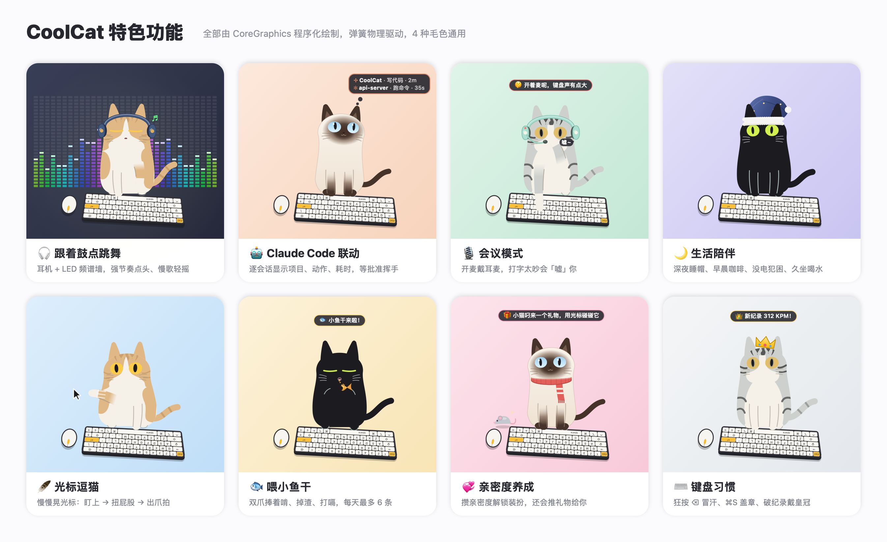
</p>

- 🎧 **Dances to your music** — headphones on when a music player is playing, a vertical LED spectrum wall behind the cat, real beat tracking via a system audio tap (macOS 14.2+) aligned to your output latency, with tap-along calibration. Moves hit the beat and accent the downbeat ([more](#-hitting-the-beat)). Strong beats get head-bobs, calm songs get slow sways. While music plays it stays at the keyboard instead of wandering off.
- 🐾 **Roams your whole screen** — when you're idle it hops off the keyboard, sprints around as a bouncy chibi, treats window tops like tables to jump between (climbing the frame when they're too high), chases your cursor, knocks your pen off a window, peeks from screen edges, curls up for naps, and runs back as soon as you type ([more](#-roaming)).
- 🍅 **Pomodoro timer** — start a 25 / 45 / 15-minute pomodoro from the menu: the cat curls up atop your front window with a tomato timer by its nose and a countdown in the menu bar, then wakes and holds up a sign telling you to take a break ([more](#-pomodoro)).
- 👟 **Kick files away** — right-click a file in Finder and pick “CoolCat 小猫踢飞（移到废纸篓）”: the file drops from its spot, the cat runs over (leaping to another display if needed) and kicks it spinning off the screen; select several and it kicks them one by one, nearest first. It only goes to the Trash, so you can always put it back ([more](#-kick-files-away)).
- 🤖 **Claude Code integration** — one-click hooks; a bubble shows *project · action · elapsed* per session, the cat waves when a session needs your approval — and if you're looking at another window, [holds up a sign](#-agent-sign) on it — and throws confetti when it is done.
- ⌨️ **Codex integration** — one-click hooks in `~/.codex/hooks.json` (trust them once via `/hooks` in Codex); Codex sessions share the bubble with Claude Code, marked by a blue spinner.
- 🎙 **Meeting mode** — headset when the mic is on, a "shh" when you type too loudly, a quick face wash before the camera turns on.
- 🌙 **Life companion** — nightcap late at night, morning coffee, sleepy on low battery, a water reminder after 50 minutes of work (left to the pomodoro while one is running).
- ❄️ **Winter & Christmas** — a santa hat and Christmas gifts in December, light snow all winter, and [snow piling up on your windows](#-winter--christmas) for the cat to leave paw prints in.
- 🪶 **Cursor play** — move the cursor slowly in front of the cat: it locks on, wiggles, and swats.
- 🐟 **Fish treats** — it holds the treat with both paws, nibbles, drops crumbs and burps (6 per day).
- 💞 **Bond levels** — every interaction builds affection (capped per day, never decays). Level up to unlock a bell collar, knitted scarf, bow and sunglasses; at higher levels it nuzzles your resting cursor and brings you a daily gift.
- 🐱 **13 cats** — the classic black, Siamese, shorthair and orange-white, plus orange tabby, Dragon Li, tuxedo, calico, British Blue, Scottish Fold, Ragdoll, white and golden.
- ⌨️ **Keyboard habits** and 😺 **idle animations**.

## 🐾 Roaming

<p align="center">
  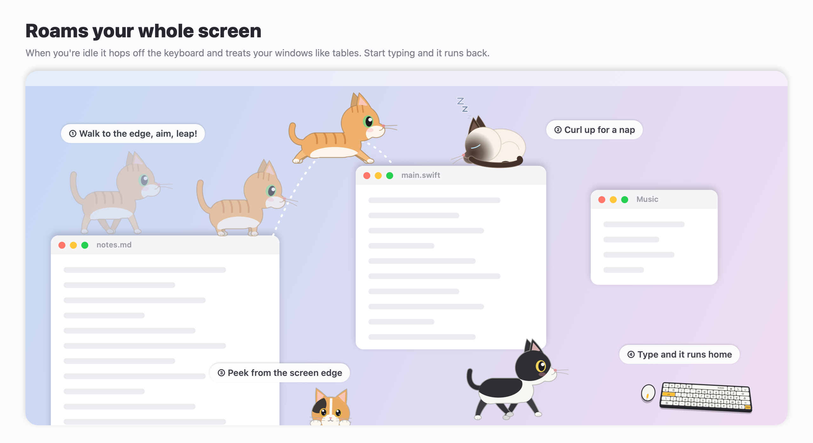
</p>

After 30 seconds without typing the cat leaves its keyboard and wanders around in a separate, fully click-through window:

- **Windows are tables** — it walks along window tops, crouches at the edge to aim and leaps across the gap to the next window. It can jump straight from its seat onto a nearby window and hops window to window on the way home. If a window moves it rides along; if the window closes it falls. A window needs some room above it to stand on (maximized windows pinned to the menu bar don't count).
- **Climbing** — real window tops are usually far higher than the cat can jump, so it walks to the frame and climbs up the side, then keeps hopping from the top (leaping onto the frame first if the window floats). *Settings → Interaction* shows live how many tops and frames are usable, and why there are none.
- **Cursor play** — wiggle the cursor slowly near a roaming cat: it stares, creeps closer, wiggles its butt and pounces, jumping for a cursor in mid-air; flick the cursor and it gallops after it. Catches earn bond points; after three pounces it takes a break.

<p align="center">
  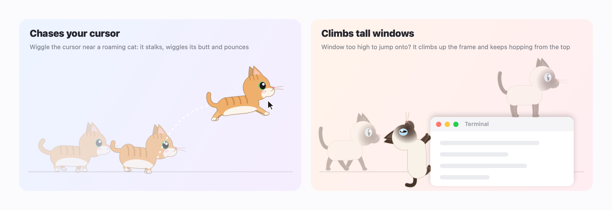
</p>

- **Knocking things off** — now and then it heads out with something from your desk in its mouth (a pen, an eraser, a bottle cap, a paper ball, a hair tie), sets it down by the edge of a window it can reach, stares at it, swats it out bit by bit (pausing to stare again), and leans over to watch it tumble off. It lands on a lower window or the bottom of the screen, bounces, paper balls and caps roll a bit, and it fades out after 25 seconds. Move the window and anything resting on it falls too. Start typing on the way and it drops the item and runs home.

<p align="center">
  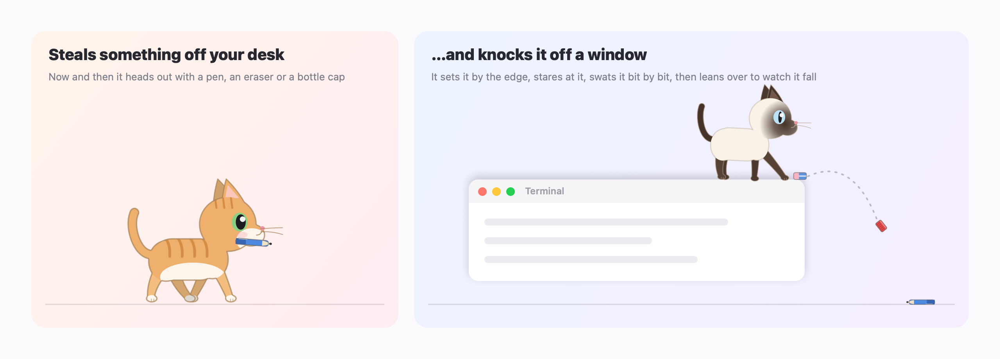
</p>

- **Peeking** — it hides past the bottom or side edge of the screen with only its head and two paws showing, clipped so it never spills onto another display.
- **Naps** — it curls up into a ball (high window tops are its favourite), breathing slowly with floating Zzz. The longer you're idle, the sleepier it gets.
- **A bouncy chibi on the move** — while roaming it's a 3/4-view chibi with a big head, two big eyes, a pink nose and an ω mouth. It walks with a planted four-beat gait (no foot sliding) and sprints in light leaps two or three times a second, ears pinned back, head steady, an S-shaped tail streaming behind and a little dust and speed lines. Now and then it gets the zoomies, then skids to a crouching stop with squinting eyes and a puff of dust (stopping dead instead when it's about to jump, hold up a sign or set something down). Turns are smooth, it crouches before a jump, squashes on landing, and a soft shadow follows its feet.

<p align="center">
  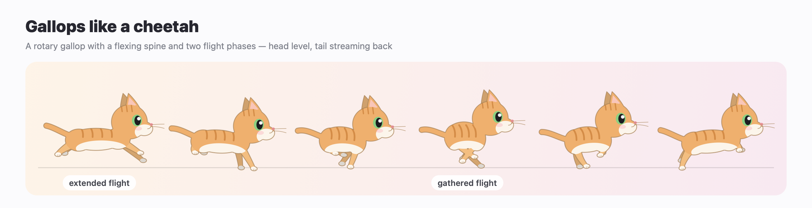
</p>

- **Comes back when needed** — typing sends it running home (a napping cat wakes with a start); it stays home during meetings or snacks, sticks to the keyboard dancing along while music plays (and gallops back if a song starts mid-walk), and comes back to remind you when Claude Code / Codex is waiting for your approval (or, if you're busy in another window, runs over and [holds up a sign](#-agent-sign)). After 10 minutes away from the keyboard it stops wandering and naps at its seat.

Turn roaming (or just the knocking) off under *Settings → Interaction*, where preview buttons trigger a walk, a peek, window hops, a nap or a knock-off on demand.

## 🙋 Agent sign

<p align="center">
  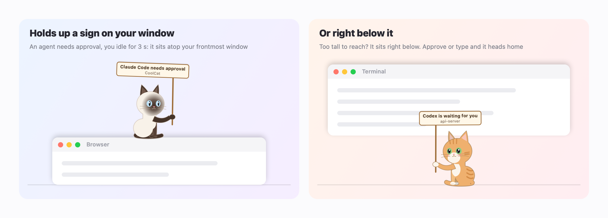
</p>

When Claude Code or Codex stops to wait for your approval or reply while you're reading docs in another window and haven't typed for 3 seconds, the cat hops off the keyboard, runs to the frontmost window on its screen, sits on top of it and holds up a little sign reading "Claude Code needs approval" with the project name.

- **Getting there** — it jumps if it can, climbs the frame when the window is too tall, and sits on the screen edge right below the window when there's no room on top (a maximized window, say). Switch windows and it moves over to the new one.
- **Knows when to stop** — once you approve (or the agent stops waiting) it puts the sign down and strolls home; start typing on the way and it takes that as "I'm on it" and won't come back for that wait.
- **Stays polite** — it skips this during meetings but still goes while music plays (an agent waiting on you beats dancing). A napping cat wakes with a start first.
- It only reads window positions and sizes, never their contents, and needs no screen-recording permission.

Turn it off under *Settings → Interaction*; the *Sign preview* button pretends an agent is waiting for 20 seconds so you can see it right away.

## 🍅 Pomodoro

<p align="center">
  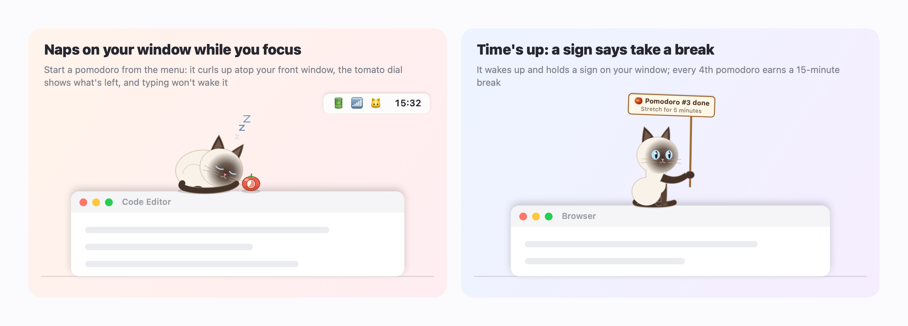
</p>

Click the menu bar icon or right-click the cat → “🍅 番茄钟” (Pomodoro), then pick 25, 45 or 15 minutes:

- **Keeps you company** — the cat hops off its seat, runs to the top of your frontmost window and curls up to sleep, with a tomato timer by its nose whose red wedge shows the time left. The menu bar icon shows a countdown (with ☕ during the break).
- **Doesn't get in the way** — typing is expected now, so it won't run home, chase the cursor or wander off. Only a meeting sends it back to its seat, and it returns afterwards. If Claude Code needs your approval it wakes up to [hold a sign](#-agent-sign), then goes back to sleep.
- **Stays put** — it doesn't follow you from window to window; if its window closes or gets covered, it drops down and moves to your current front window. Too tall to reach? It sleeps on the screen edge right below.
- **Time's up** — it wakes and holds up a sign on your front window: “🍅 第 N 个番茄完成 / 起来活动 5 分钟吧” (pomodoro N done, stretch for 5 minutes). After a few seconds, typing counts as “seen”; otherwise it holds the sign for up to 45 seconds. Every 4th pomodoro earns a 15-minute break, and a bubble pops up when the break is over.
- **Menu** — end a pomodoro early, skip a break to start the next one, and see how many you finished today.
- It runs on wall-clock time, so it keeps counting while the lid is closed. Each pomodoro adds 3 bond points (up to 12 a day), and the 50-minute water reminder steps aside while a pomodoro is running.

## 👟 Kick files away

<p align="center">
  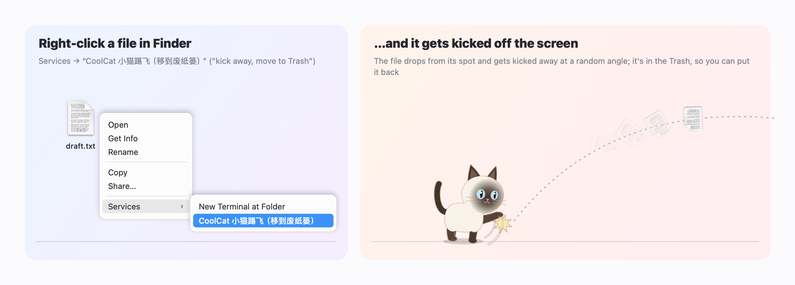
</p>

Have the cat kick away files you don't want:

1. In Finder (on the desktop or in a window), right-click the file → *Quick Actions* or *Services* → **“CoolCat 小猫踢飞（移到废纸篓）”** (“kick away, move to Trash”). You can also use the menu bar icon → “👟 小猫踢飞文件（移到废纸篓）…” and pick files.
2. The file disappears from its spot and its icon (the same thumbnail Finder shows) pops out right there, drops onto the window top or screen edge below, and bounces to a stop.
3. The cat runs over, hopping between windows and climbing frames as needed; if the file is on another display, it leaps across. The file trembles as the cat gets close.
4. A quick aim, a wind-up, and a kick with a comic “pow” star. The angle is random: a low kick sends it skimming forward, a high kick sends it up. The icon spins, shrinks into the distance and trails a few ghost images as it flies off the screen.
5. Selected several files? Each drops from its own spot and the cat kicks them one by one, nearest first. Then it watches the last one go and heads back to its seat (leaping back if it came from another display).

- **Trash only** — just like ⌘⌫ in Finder, so *Put Back* works and nothing is deleted permanently. Press Esc before the kick lands to cancel and put the file back.
- **Asks once to control Finder** — Finder moves the file itself, so the original icon vanishes immediately. It still works without that permission, but the original icon lingers for two or three seconds.
- **Won't kick** — system folders, your home folder and its Desktop / Documents / Downloads folders themselves, whole disks, anything already in the Trash, or CoolCat itself.
- You asked for it, so it goes even during meetings or while dancing.
- Up to 20 files at a time. Desktop files drop from their own spots; for files in a Finder window (whose on-screen positions Finder doesn't expose) the icons line up around where you right-clicked.
- Don't see the item in the right-click menu yet? Relaunch Finder or log out and back in once.

## 🎄 Winter & Christmas

<p align="center">
  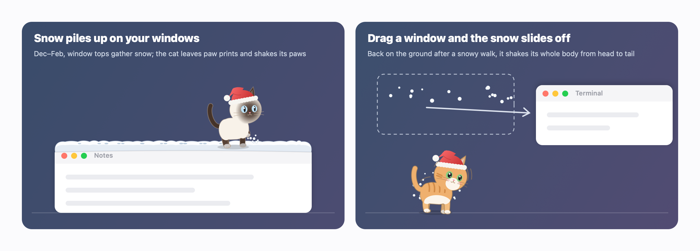
</p>

- **Christmas season (Dec 1–26)** — a santa hat whether sitting, walking, galloping, climbing or napping (no nightcap stacked on top late at night), and daily gifts become red presents with gold ribbon or candy canes. On Christmas Eve and Christmas Day it greets you with confetti the first time it sees you.
- **Light snow (Dec–Feb)** — a few flakes drift behind the cat.
- **Snow on your windows** — window tops the cat can stand on slowly gather a layer of snow (full after about 4 minutes) that drapes over the rounded corners; parts hidden behind other windows aren't drawn. Walking leaves a trail of paw prints that fresh snow fills in; running kicks up powder and landing sends up a puff.
- **Shaking it off** — after a while in the snow it stops, lifts a front paw and flicks the snow off its whitened paws; back on snow-free ground it shakes its whole body from head to tail. No shaking when it's rushing home, delivering a sign or chasing your cursor.
- **Drag a window and the snow slides off** — moving or resizing a window breaks its snow into falling clumps, and it starts piling up again in the new spot. Switch Spaces and come back: the snow is still there.
- It only reads window positions, never contents, and draws in a click-through transparent overlay.

Turn it off under *Settings → Appearance → Holiday*; *Preview 30 s* shows it any time of year (window tops fill up in a few seconds).

## 🎚 Hitting the beat

<p align="center">
  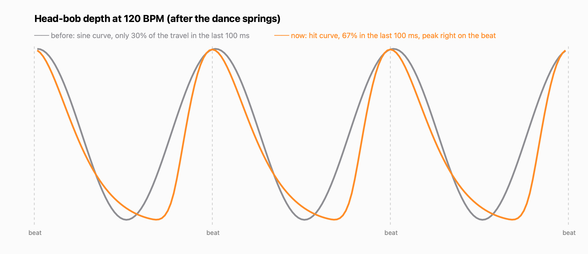
</p>

- **On the beat** — nods, bounces, head-bangs and raised paws arrive fast and stop dead on the beat, then ease back, instead of a constant sine sway. Measured through the actual dance springs, the peak lands right on the beat.
- **Feels the bar** — the downbeat is found from kick-drum weight per beat position; beat 1 is accented and moves change at bar starts.
- **Soft when unsure** — while the tempo is still being found it only does calm sways; once the tempo is stable it dances rhythmic moves, kept soft until the phase locks and snappy after. Songs in 6/8 or with a triplet feel no longer flip between 140, 93 and 70 BPM readings.
- **Tap-along calibration** — Bluetooth headphones often misreport their latency. In *Settings → Music → Beat calibration*, play a song with a clear kick and tap space on the beat 12 times; the offset is measured, applied and remembered per output device. A slider and a beat light let you fine-tune by eye.

## ⚙️ Settings window

A System Settings–style window (menu bar icon / right-click the cat → *Settings…*, or ⌘,) with a live-rendered preview cat.

<table>
  <tr>
    <td></td>
    <td>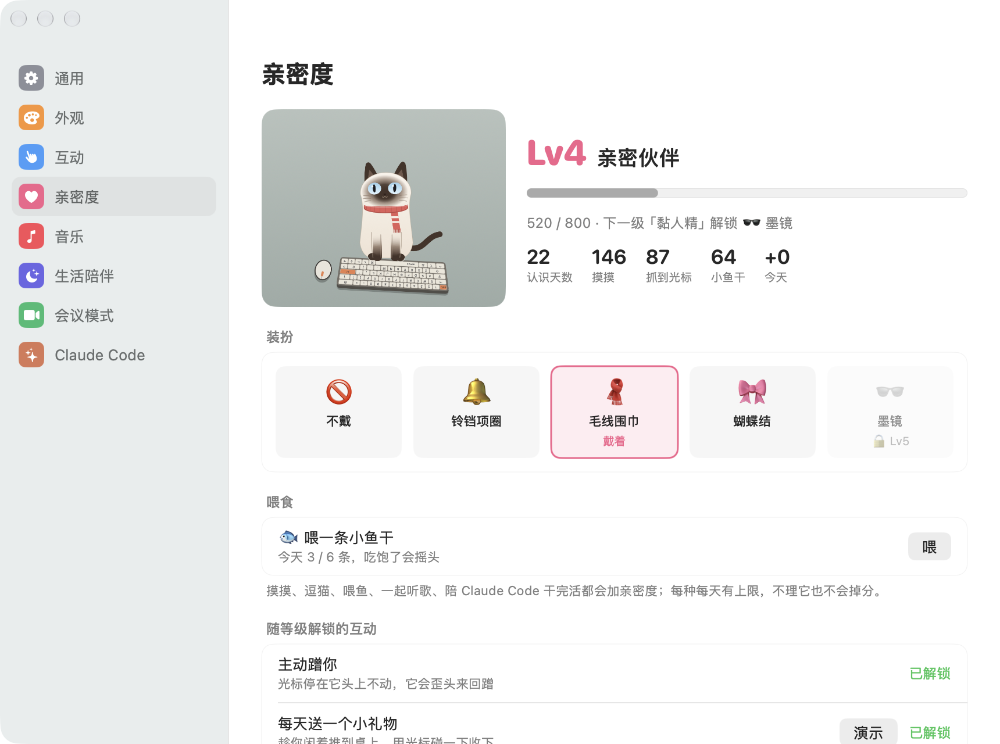</td>
  </tr>
</table>

## 📦 Build

macOS 11+ (real-time beat tracking needs macOS 14.2+).

```bash
./build.sh && open CoolCat.app
```

Requires *Input Monitoring*; *Screen & System Audio Recording* is optional and only used to analyze the music player's audio in memory. Package with `scripts/package-macos.sh`. The UI is in Simplified Chinese.

Debug flags: `--focus-now --focus-seconds 40` runs a whole pomodoro cycle in a couple of minutes (without counting it or adding bond points); `--kick-file <path> [--kick-at x,y]` (repeat `--kick-file` for several) has the cat kick those files two seconds after launch (it really goes to the Trash), popping out at the given screen point.

For beat diagnostics, launch with `open -a CoolCat --args --beat-log <file>` to log lock stats, tempo candidates and track titles every 5 seconds.

## 🔒 Privacy

- Keyboard and mouse events only drive animations and counters; nothing you type is recorded or uploaded.
- System audio is limited to the music player and analyzed in memory only.
- Agent hooks send only event names, tool names and the project folder name to the local cat — never prompts or code.
- Roaming reads window positions and sizes to find places to stand, never window contents, and needs no screen-recording permission.
- Kicking files only happens after you pick files and a menu item, and only moves those files to the Trash (they can be put back). The Finder automation permission is used for nothing else.
- No network access, no update checks.

## 📄 License

[MIT License](LICENSE), keeping the original copyright notice of [chanke17/KuroCat](https://github.com/chanke17/KuroCat).
