<p align="center">
  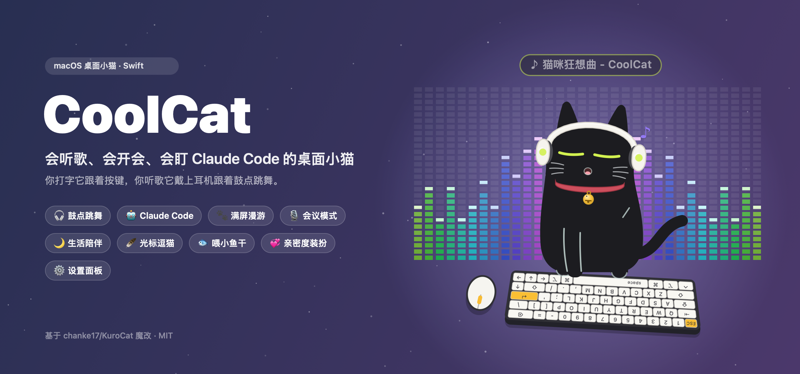
</p>

<p align="center">
  <b>简体中文</b> | <a href="README.en.md">English</a>
</p>

# 🐱 CoolCat

一只住在你 Mac 桌面角落的小猫：你打字，它跟着按键；你听歌，它戴上耳机跟着鼓点跳舞；你用 Claude Code，它帮你盯着每一个会话；你闲下来，它会盯着光标扭屁股、捧着小鱼干啃，还会悄悄送你一份礼物。

> 🙏 **致谢**：CoolCat 基于 **[chanke17/KuroCat](https://github.com/chanke17/KuroCat)** 魔改而来。
> 键盘鼠标全状态捕获、2.5D 球面头部追踪、四种毛色和整套 CoreGraphics 程序化绘制，这些地基都来自原作者，非常感谢 [@chanke17](https://github.com/chanke17) 的开源！
> 原项目以 MIT 协议开源，本仓库沿用 MIT，并在 [LICENSE](LICENSE) 中保留原作者的版权声明。
> 漫游小猫的 Q 版重绘（3/4 侧脸大头、轻快飞奔、急刹和转身过渡）来自 [LuoYangcan](https://github.com/LuoYangcan)，谢谢！

## ✨ 特色功能

<p align="center">
  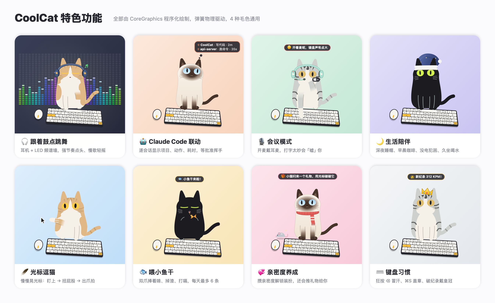
</p>

| | 功能 | 说明 |
|---|---|---|
| 🎧 | **跟着鼓点跳舞** | 音乐播放器一出声就戴上耳机；猫身后立起一面 LED 频谱墙。用系统音频 tap（macOS 14.2+）实时检测鼓点，舞步按输出设备延迟对齐到你听到的拍子，还能跟拍校准。动作卡在拍点上，小节第一拍更重；强节奏多点头，舒缓的歌慢慢摇。放歌时它不出去溜达，守在键盘前陪你听。详见[下文](#-卡点与节拍校准)。 |
| 🐾 | **满屏漫游** | 闲下来就跳下键盘满屏溜达：Q 版小猫轻快飞奔、到地方急刹，把窗口顶当桌子跳来跳去、太高就顺着窗框爬上去，追着你的光标扑，叼走你桌上的笔推下窗口，躲在屏幕边只露脑袋偷看，找个地方蜷成一团打盹；你一打字就跑回来。详见[下文](#-满屏漫游)。 |
| 🍅 | **番茄钟** | 菜单里开一个番茄（25 / 45 / 15 分钟），小猫跑到你最前面的窗口顶上蜷成一团陪你专注，鼻尖前摆着番茄计时器，菜单栏显示倒计时；到点醒过来举牌叫你休息。详见[下文](#-番茄钟)。 |
| 👟 | **踢飞文件** | Finder 里右键文件选「CoolCat 小猫踢飞（移到废纸篓）」：文件从原来的地方掉下来，小猫跑过去（在另一块屏幕上就跳过去）一脚踢飞，转着圈飞出屏幕；选了好几个就从近到远一个个踢。只是移到废纸篓，随时能放回。详见[下文](#-踢飞文件)。 |
| 🏠 | **串门** | 给小猫取个名字：同一个局域网里装了 CoolCat 的同事，小猫闲着时自己决定去谁家，走出屏幕边去他那儿溜达一圈；他的猫也会从你屏幕边跳进来，头上顶着名字，先跑来跟你的猫打招呼。不用谁点同意。详见[下文](#-串门)。 |
| 🤖 | **Claude Code 联动** | 一键写入 hook。气泡逐会话显示「项目 · 动作 · 耗时」，多个会话同时在忙也分得清；等你批准时举爪挥手，你没注意到就跑去你正在看的窗口上[举牌](#-举牌提醒)，任务完成撒彩带。 |
| ⌨️ | **Codex 联动** | 一键写入 `~/.codex/hooks.json`（在 Codex 里 `/hooks` 信任后生效）。和 Claude Code 共用一个气泡：Codex 会话用蓝色转圈标出，等你批准、按 Esc 打断、完成都能同步。 |
| 🎙 | **会议模式** | 开麦自动戴耳麦，开麦时打字太猛会「嘘」你，开摄像头前先洗把脸。 |
| 🌙 | **生活陪伴** | 深夜戴睡帽提醒早点睡，早上第一次开工端咖啡，低电量没精神、插电喝奶，连续工作 50 分钟提醒喝水（开着番茄钟时交给番茄钟提醒）。 |
| ❄️ | **冬天与圣诞** | 12 月戴圣诞帽、送圣诞礼物；冬天身后飘小雪，窗口顶会[积雪](#-冬天与圣诞)，小猫走过踩出脚印、抖抖爪子。 |
| 🪶 | **光标逗猫** | 在它身前慢慢晃光标：盯上 → 压低扭屁股 → 出爪拍。出爪那一刻光标还在就算抓到，连抓三下有奖励。 |
| 🐟 | **喂小鱼干** | 小鱼干从天而降，双爪捧着啃三口、掉渣、打嗝；每天最多 6 条，吃饱了会摇头。 |
| 💞 | **亲密度养成** | 摸摸、逗猫、喂鱼、一起听歌、陪 Claude 干活都会攒亲密度（每天封顶、只增不减）。升级解锁铃铛项圈、毛线围巾、蝴蝶结、墨镜；熟了会主动蹭你的光标，每天还会推一个小礼物到桌上。 |
| ⌨️ | **键盘习惯** | 狂按退格冒汗、⌘S 盖章、截图比耶、手速破纪录戴皇冠。 |
| 🐱 | **13 只猫咪** | 经典的小黑猫、暹罗、美短、橘白，加上大橘、狸花、奶牛、三花、英短蓝、折耳、布偶、小白、金渐层；在「设置 → 外观」里点缩略图切换。 |
| 😺 | **空闲小动作** | 打哈欠、伸懒腰、踩奶、舔爪、东张西望、看尾巴、慢眨眼。 |

## 🐾 满屏漫游

<p align="center">
  
</p>

30 秒没打字，小猫就会自己跳下键盘出门溜达，在一个独立的透明窗口里走、跑、跳，点击完全穿透，不挡你操作：

- **窗口当跳台**：桌面上的窗口就是一张张桌子。它会在窗口顶上走，走到桌边蹲下瞄准，跨过缝隙跳到另一扇窗口上；出门时会直接从座位跳上旁边的窗口，回家时顺着窗口一路跳回去。窗口挪动时它跟着动，窗口关掉它会掉下来。窗口上方得留点空间它才站得上去，最大化、贴着菜单栏的窗口不算。
- **爬窗户**：真实桌面上的窗口顶往往比小猫能跳的高得多，它会走到窗框旁边，顺着侧边爬上去，翻上窗口顶再继续跳；窗口悬空的话先跳起来抓住窗框。「设置 → 互动」里会实时显示现在有几处能跳、几条窗框能爬，一处都没有时说明原因（比如窗口顶上空间不够）。
- **追光标**：溜达时在它前面慢慢晃光标，它会停下盯着看，压低身子挪近，扭屁股蓄力，然后扑过去，光标在半空就跳起来够；一甩光标它就飞奔去追。抓到能攒亲密度，一轮最多扑三次就歇一会儿。

<p align="center">
  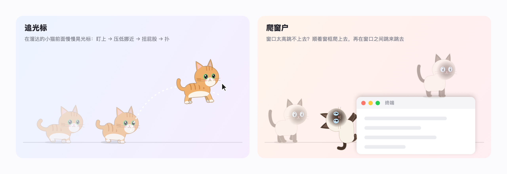
</p>

- **把东西推下桌**：出门时偶尔叼走你桌上的一样小东西（笔、橡皮、瓶盖、纸团、发圈），跑到一扇够得着的窗口边上放下，盯着看一会儿，再用爪子一下下往外拨，偶尔停下来再盯一眼；推过边就翻着跟头掉下去，猫还要探头看着它掉。东西落到下面的窗口顶或屏幕底，弹两下、纸团和瓶盖还会滚一段，躺 25 秒后淡出。窗口一挪，躺在上面的东西也会掉下去。路上你一打字，它就把东西一丢跑回去。

<p align="center">
  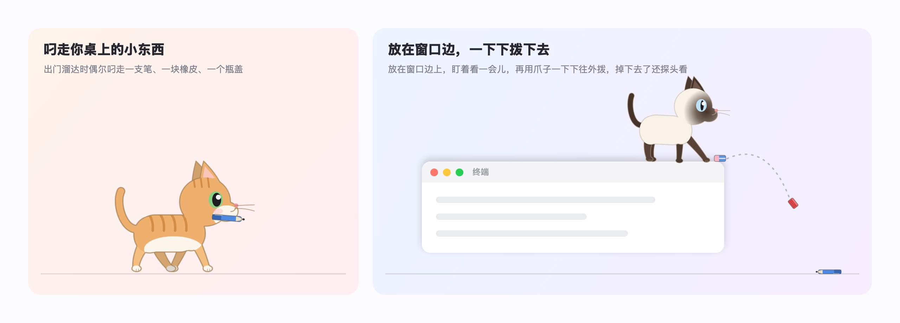
</p>

- **边上偷看**：躲到屏幕底边或侧边外面，只露出脑袋和两只扒着边的爪子，东张西望。多屏时不会画到隔壁屏幕上。
- **蜷成一团打盹**：找个地方趴下慢慢蜷起来，最爱窗口顶上的高处，睡着时会呼吸起伏、冒 Zzz。闲得越久越容易犯困。
- **Q 版小猫满屏跑**：漫游时是 3/4 侧脸的 Q 版大头小猫，两只大眼睛、粉鼻子、ω 嘴。走路是四拍步态，脚掌贴地不打滑；跑起来一秒两三次轻快大跳，耳朵往后压、头稳稳平视，身后拖着 S 形小尾巴，还有一点烟尘和速度线。溜达时会突然发疯狂奔一段，跑到地方压低身子急刹、眯起眼扬起一小团烟（要在那儿起跳、举牌、放东西时就原地刹住）。转身是顺滑过渡，起跳前蹲下蓄力，落地时压扁一下，脚下一直跟着一团影子。

<p align="center">
  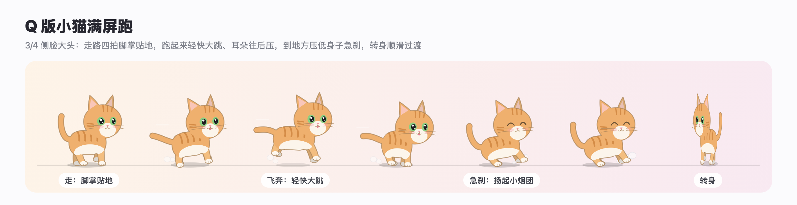
</p>

- **随叫随回**：你一打字它就跑回键盘，睡着的会一激灵醒来再跑；开会、吃小鱼干时不出门；放歌时守在键盘前跟着节奏摇，正在外面溜达的听到音乐也会飞奔回来跳舞；Claude Code / Codex 在等你批准时会跑回来提醒你（你在看别的窗口时改成跑过去[举牌](#-举牌提醒)）。离开超过 10 分钟就不再出门，安心在座位上睡觉。

「设置 → 互动」里可以关掉漫游、单独关掉「把东西推下桌」，也有「出发」「偷看」「跳台」「打盹」「推东西」几个预览按钮，点一下马上看效果。

## 🙋 举牌提醒

<p align="center">
  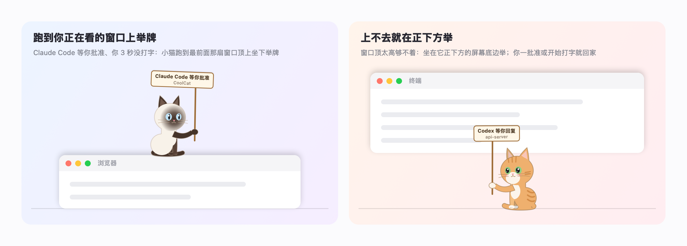
</p>

Claude Code 或 Codex 停下来等你批准、等你回复，你却在别的窗口里看文档、刷网页，3 秒没打字：小猫会跳下键盘，跑到你这块屏幕最前面的那扇窗口，坐在窗口顶上举起一块小牌子，写着「Claude Code 等你批准」和项目名。

- **路线**：能直接跳就跳，太高就顺着窗框爬上去；窗口顶上站不下（比如最大化的窗口），就坐在它正下方的屏幕底边举。举着牌时你换了窗口，它会挪到新窗口去。
- **见好就收**：你一批准（或 agent 不等了）它就放下牌子慢慢回家；路上你开始打字，说明你已经在处理了，这次等待不会再跑过去。
- **不打扰**：开会时不去；听歌时照样去，agent 等你比跟着歌摇更要紧。正在打盹的会一激灵醒来再去。
- 只读窗口的位置和大小，不读窗口内容，也不需要录屏权限。

「设置 → 互动」里可以关掉举牌提醒，点「举牌预览」能假装 agent 等你 20 秒，马上看效果。

## 🍅 番茄钟

<p align="center">
  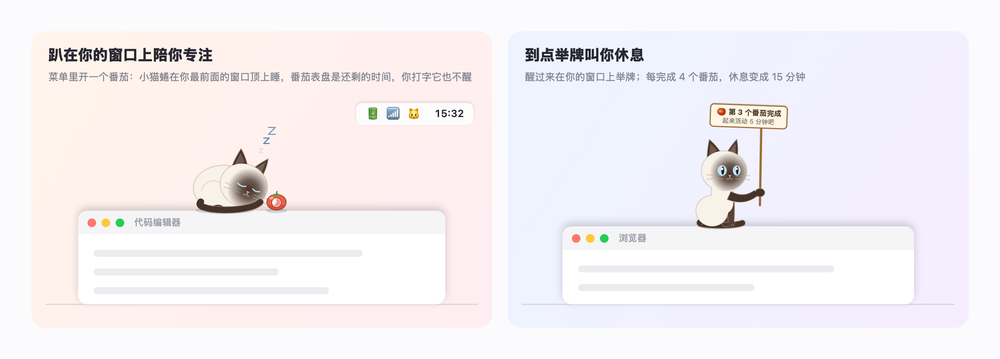
</p>

点菜单栏图标或右键小猫 →「🍅 番茄钟」，选专注 25、45 或 15 分钟：

- **陪你专注**：小猫跳下座位，跑到你最前面那扇窗口顶上蜷成一团睡，鼻尖前摆着一个番茄计时器，表盘上的红色扇形是还剩的时间。菜单栏的小猫图标右边显示倒计时，休息时带个 ☕。
- **不打扰**：这时候你打字很正常，它不会跑回家，也不追光标、不出去玩。只有开会时会回座位，会开完再回去接着睡。Claude Code 等你批准时它会醒来去[举牌](#-举牌提醒)，你批准了再回去接着睡。
- **换窗口不搬家**：选好的地方不跟着你切窗口来回跑；那扇窗口关了、被挡住了，它掉下来换到你现在最前面的窗口上。窗口太高够不着，就睡在它正下方的屏幕底边。
- **到点举牌**：醒过来在你最前面的窗口上举牌「🍅 第 N 个番茄完成 / 起来活动 5 分钟吧」。举起来几秒后你一打字就算看到了，最多举 45 秒。每完成 4 个番茄，休息变成 15 分钟；休息结束时头顶冒「☕ 休息好啦，再来一个番茄？」。
- **菜单**：专注中可以提前结束，休息中可以跳过休息直接开始下一个，还能看到今天完成了几个。
- 按墙上时间计时，合盖睡一觉番茄照样往前走。每完成一个番茄 +3 亲密度（每天最多 12）。开着番茄钟时，「连续工作 50 分钟提醒喝水」先让给番茄钟。

## 👟 踢飞文件

<p align="center">
  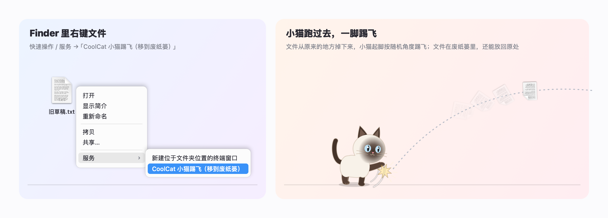
</p>

不想要的文件，让小猫一脚踢走：

1. 在 Finder 里（桌面上或窗口里）选中文件，右键 →「快速操作」或「服务」→ **「CoolCat 小猫踢飞（移到废纸篓）」**。也可以点菜单栏图标 →「👟 小猫踢飞文件（移到废纸篓）…」选文件。
2. 文件从原来的位置消失，同一个地方蹦出它的图标（和 Finder 里一样的缩略图），掉到下面的窗口顶或屏幕底边上，弹两下站稳。
3. 小猫跑过去，跳台、爬窗框都会用；文件在另一块屏幕上就一个大跳跳过去。走近时文件会瑟瑟发抖。
4. 瞄一眼、往后蓄力、一脚踢出去，「砰」地炸开一颗星。踢的角度是随机的：低踢就贴着往前飞，高踢就往上飞，图标边转边越飞越远，拖着几道残影飞出屏幕。
5. 选了好几个文件：每个都从自己原来的位置掉下来，小猫从离它最近的开始一个个踢飞，全踢完再站着目送一会儿，跑回座位（从别的屏幕跳回来）。

- **只是移到废纸篓**：和在 Finder 里按 ⌘⌫ 一样，可以在废纸篓里「放回原处」，不会永久删除。踢出去之前按 Esc 可以取消，文件放回原处。
- **第一次用会请你授权「控制 Finder」**：让 Finder 自己去移文件，桌面上原来的图标才会马上消失；不授权也能踢，只是原图标会多留两三秒。
- **不让踢的**：系统目录、你的主目录和「桌面 / 文稿 / 下载」这几个文件夹本身、整块磁盘、已经在废纸篓里的东西、CoolCat 自己。
- 这是你叫它做的事，开会、跳舞时也会去。
- 一次最多踢 20 个。桌面上的文件从各自的位置掉下来；Finder 窗口里的文件拿不到各自在屏幕上的位置，就以你右键的地方为中心横着排开掉下来。
- 右键菜单里一时没看到这一项：重启一下 Finder，或注销再登录一次。

## 🏠 串门

和同事的小猫互相串门。默认打开，不用设置，也不用谁点同意：同一个局域网里装了 CoolCat 的同事，小猫自己会找到彼此。

- **取个名字**：在「设置 → 外观」里给小猫取名字（最多 12 个字）。去同事家时，名字顶在它头上；不取就显示品种名（暹罗、大橘……）。
- **小猫自己决定**：闲着出门溜达时，它偶尔会自己挑一位同事去串门；想让它马上去，也可以在菜单「🏠 串门」里点「去「XX」家串门」。你的猫跳下座位，走出屏幕边；同一时刻，同事屏幕边跳进来一只和它一模一样的猫（毛色、品种、装扮都一样），头上顶着名字。
- **在同事家**：先跑到同事的猫旁边坐下打个招呼（同事那边冒「👋 「XX」来串门啦」），再在他屏幕上溜达，跳窗口、追光标都会。最多待一分多钟，然后从屏幕边跳出去；你的猫随后从你这边的屏幕边走回来，回到座位。
- **一起玩**：同事的猫一进门，你的猫放下手头的事（坐在键盘前陪你打字也跳下来）跑去找它玩：盯着它扭屁股扑过去、凑过去碰碰鼻子、从它身边疯跑过去让它追，客人也会扑回来。你在打字的话，它至少玩 8 秒就回座位接着工作；过 20～40 秒，客人还在就又惦记着跳下去玩一会儿，直到客人走。开会、agent 等你批准、开着番茄钟时不去玩。
- **随叫随回**：你这边开会、Claude Code / Codex 等你批准、要踢文件、开了番茄钟，或者关了串门，在外面的猫马上回来，同事那边的客人也立刻告辞。对方关了电脑、断了网，同样会各自回家。
- **不限客人**：几位同事的猫可以同时来，进门后一只挨一只排开打招呼；你的猫出门在外时，家里也照样接待客人。只有两种情况会婉拒：你正在开会（可能在共享屏幕，突然跳进来一只猫挺尴尬），或者屏幕上已经有 4 只客人猫了（免得挤成一团）。

只在局域网里用 Bonjour 互相发现，不经过任何服务器。交换的只有小猫的名片：名字、品种、毛色、瞳色、装扮。不会发电脑名、屏幕内容或任何别的东西。第一次启动时 macOS 会请你允许「本地网络」，不允许的话设置里会提示你去哪儿打开。不想串门的话，在「设置 → 互动 → 串门 🏠」里关掉。

「设置 → 互动 → 串门」里能看到局域网里找到了哪几位同事，点「去串门」马上出发；「客人预览」不走网络，假装同事的猫「阿橘」来串门，马上就能看到效果。

## 🎄 冬天与圣诞

<p align="center">
  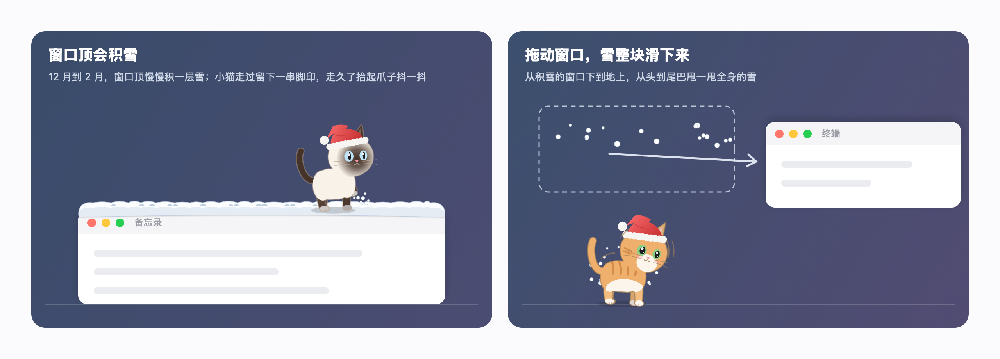
</p>

- **圣诞季（12/1–12/26）**：坐着、走路、飞奔、爬窗、打盹时都戴圣诞帽（深夜不再叠一顶睡帽），每天的礼物换成系金丝带的红礼盒或拐杖糖。平安夜和圣诞节当天第一次见面会打招呼、撒彩带。
- **下小雪（12 月到 2 月）**：小猫身后飘着稀疏的小雪。
- **窗口顶积雪**：能站的窗口上沿慢慢积起一层雪（大约 4 分钟积满），两端从圆角上耷拉下来，被前面窗口挡住的那段不画。小猫走过留下一串脚印，过一会儿被新雪填平；跑起来往后踢雪沫，跳上来溅起一圈雪。
- **抖雪**：在雪里走久了，站住抬起一只前爪甩一甩，沾白的爪子抖干净；从积雪的窗口下到地上，从头到尾巴甩一甩全身的雪。急着回家、送牌、逗猫时不抖。
- **拖窗口雪会滑**：一拖动、一改大小，窗口上的雪就碎成雪块掉下去，在新位置重新积。切到别的桌面再回来，雪还在。
- 只读窗口位置，不读内容；积雪画在一层点击穿透的透明窗口里，不挡你操作。

「设置 → 外观 → 节日」里可以关掉节日装扮，点「预览 30 秒」不到 12 月也能看效果（窗口顶几秒就积满雪）。

## 🎚 卡点与节拍校准

<p align="center">
  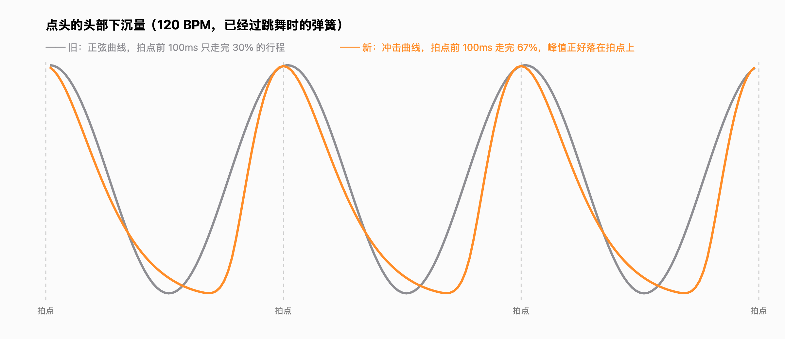
</p>

- **卡在拍点上**：点头、弹跳、甩头、举爪这些舞步，在拍点前快速到位、拍点上急停，之后再慢慢回去，不再是匀速的正弦摇摆。按跳舞时的弹簧实测，动作峰值正好落在拍点上。
- **跟着小节走**：从每拍的底鼓轻重认出小节第一拍，第一拍点得更重，换舞步也只在小节开头换。
- **没把握就放软**：速度还在找（BPM 乱跳）时只跳摇椅、轻轻摇摆这类柔和舞步；速度稳了就跳有节奏的舞步，相位还没锁准时动作放软，锁准了才硬卡点。三连音、6/8 这类几种数法都说得通的歌，速度不会在 140、93、70 之间来回跳。
- **跟拍校准**：蓝牙耳机、外接音箱自报的延迟常常不准。在「设置 → 音乐 → 节拍校准」里放一首鼓点清楚的歌，跟着底鼓按 12 下空格，就能算出小猫比你听到的早还是晚，自动修正，按输出设备分别记住。也可以直接拖滑块微调；节拍灯会在小猫认为的拍点上闪，方便对照。

## ⚙️ 设置面板

菜单栏只保留常用操作，其余开关都在仿「系统设置」风格的设置窗口里（菜单栏图标 / 右键小猫 →「设置…」，或 ⌘,）。外观页和亲密度页带一只实时渲染的预览小猫，换毛色、瞳色、装扮立刻能看到。

<table>
  <tr>
    <td>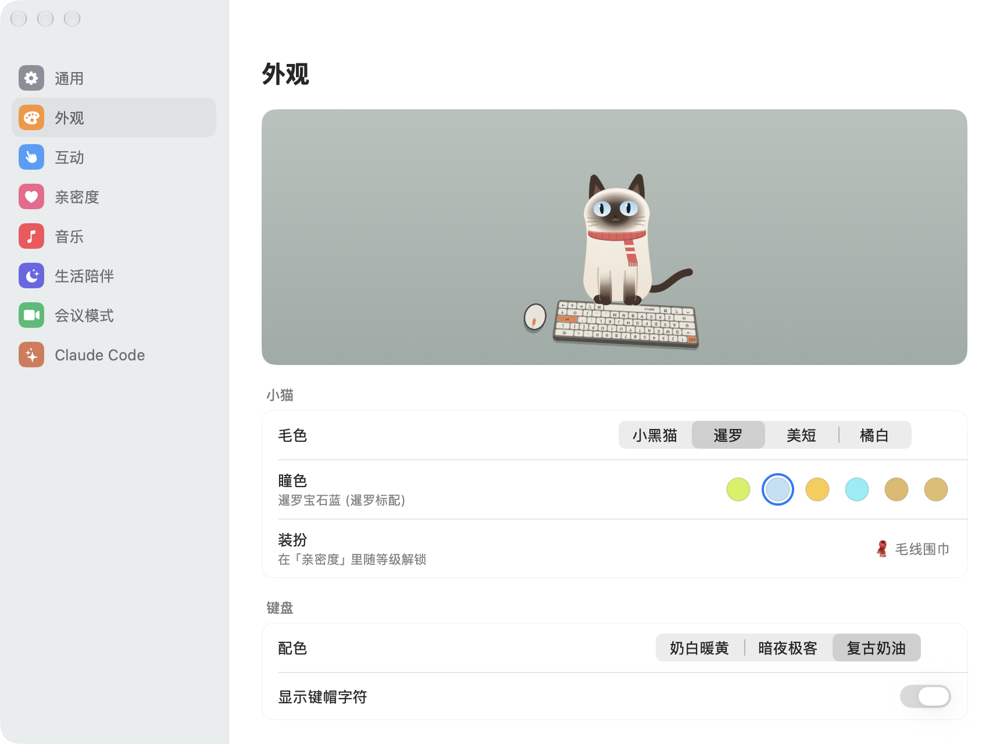</td>
    <td>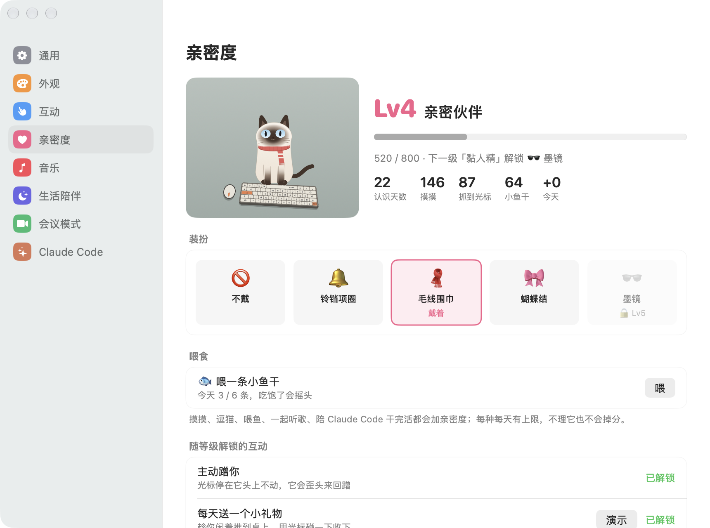</td>
  </tr>
  <tr>
    <td align="center">外观：毛色、瞳色、键盘配色，实时预览</td>
    <td align="center">亲密度：等级、相处统计、装扮</td>
  </tr>
</table>

<p align="center">
  <br/>
  Claude Code：一键连接 / 断开，逐会话查看状态
</p>

## 📦 构建与运行

要求 macOS 11+（实时音频节拍需要 macOS 14.2+，更低版本自动用模拟节拍）。

```bash
./build.sh && open CoolCat.app
```

首次运行需要的授权：

- **输入监控**（必需）：让小猫跟着你的键盘鼠标动。只用于动画和按键计数，不记录你输入的内容。
- **录屏与系统录音**（可选）：只读取音乐播放器的声音、只在内存里做频谱分析，用来让舞步踩准鼓点。不授权也能跳，只是用模拟节拍。

打一个发给别人的包（Developer ID 签名 + 加固运行时，可选公证；zip 里附安装说明）：

```bash
COOLCAT_SIGN_IDENTITY="Developer ID Application: XXX (TEAMID)" \
COOLCAT_NOTARY_PROFILE=<notarytool 钥匙串配置名，可省略> \
scripts/package-macos.sh
```

从 KuroCat 升级：首次启动会自动迁移设置、开机自启和 Claude Code hook；因为包标识改为 `ai.today.coolcat`，需要重新授权「输入监控」和「录制系统音频」。

## 🔒 隐私

- 键盘鼠标事件只驱动动画和统计次数，不记录、不上传任何输入内容。
- 系统音频只取音乐播放器的声音，在内存中实时分析后即丢弃。
- Claude Code hook 只把事件名、工具名、项目文件夹名发给本机的小猫，不读取提示词和代码；修改前会备份 `~/.claude/settings.json`。
- 满屏漫游只读取窗口的位置和大小来找落脚点，不读窗口内容，也不需要屏幕录制权限。
- 串门默认打开（可以在设置里关掉）：只在局域网里用 Bonjour 找装了 CoolCat 的同事，只交换小猫的名字和样子，不经过任何服务器。
- 踢飞文件只在你选中文件、点了菜单之后才动，只把这些文件移到废纸篓（能放回原处）；「控制 Finder」的授权只用来让 Finder 移这些文件，不做别的。
- 不联网，不检查更新。

## 🧪 开发

所有动画都可以离屏渲染成图片检查，例如：

```bash
swiftc -swift-version 5 -O -framework AppKit -framework SwiftUI -framework IOKit -framework CoreAudio \
  -framework CoreMediaIO -framework Accelerate -framework ApplicationServices -framework QuickLookThumbnailing \
  Sources/*.swift -o /tmp/coolcat
/tmp/coolcat --render-readme-art assets/coolcat      # README 头图和功能卡片
/tmp/coolcat --render-dance-preview /tmp/dance.png   # 舞步
/tmp/coolcat --render-bond-preview /tmp/bond.png     # 装扮、礼物、蹭蹭
/tmp/coolcat --render-walk-preview /tmp/walk.png     # 漫游时的侧身小猫（COOLCAT_WALK_SET=nap 看打盹，=run 看飞奔一个周期，=kick 看踢腿）
```

跟节拍有关的诊断：`open -a CoolCat --args --beat-log <文件>` 每 5 秒记一行锁拍统计（落拍率、抖动、偏差、速度候选、是否锁稳），换歌时记下歌名。

漫游可以用启动参数直接触发：`open -a CoolCat --args --roam-now`（出门）、`--roam-peek`（偷看）、`--roam-hop`（窗口跳台）、`--roam-nap`（打盹）、`--roam-knock`（推东西），加 `--roam-log <文件>` 每半秒记一行漫游状态。

番茄钟：`--focus-now` 启动后马上开一个番茄，配合 `--focus-seconds 40` 把专注缩成 40 秒、休息缩成一半，几分钟看完一整轮（调试模式不记番茄数、不加亲密度）。

串门：`--visit-demo` 启动 2 秒后假装来了一只同事的猫（不走网络）；`--visit-peer` 一找到局域网里的同事就去串门。

踢飞文件：`--kick-file <路径>`（可以写好几个）启动 2 秒后让小猫踢这些文件（真的会移到废纸篓），加 `--kick-at x,y` 指定图标从屏幕哪儿蹦出来（屏幕坐标，相当于在那儿右键了它）。

其余还有 `--render-music-preview`、`--render-claude-preview`、`--render-meeting-preview`、`--render-life-preview`、`--render-play-preview`、`--render-habits-preview`。

## 📄 License

[MIT License](LICENSE)，并保留原作者 [chanke17/KuroCat](https://github.com/chanke17/KuroCat) 的版权声明。
