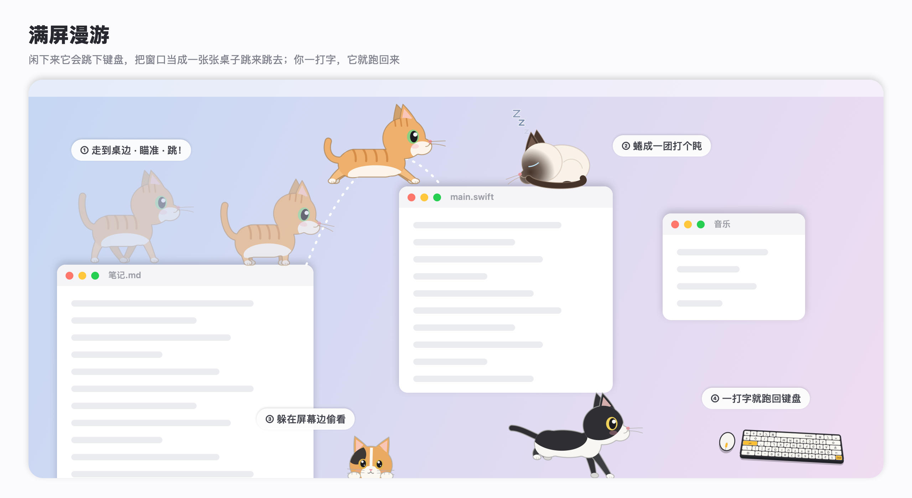
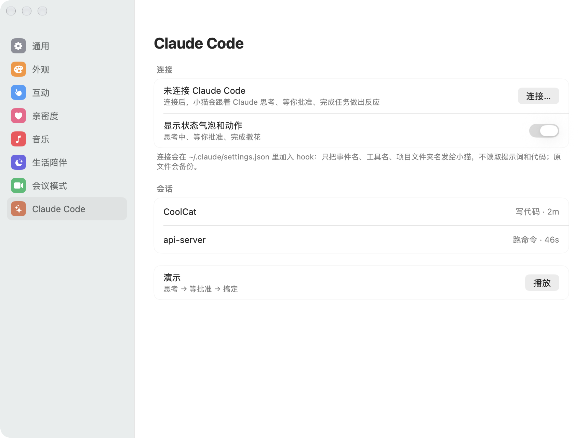

<p align="center">
  
</p>

<p align="center">
  <b>简体中文</b> | <a href="README.en.md">English</a>
</p>

# 🐱 CoolCat

一只住在你 Mac 桌面角落的小猫：你打字，它跟着按键；你听歌，它戴上耳机跟着鼓点跳舞；你用 Claude Code，它帮你盯着每一个会话；你闲下来，它会盯着光标扭屁股、捧着小鱼干啃，还会悄悄送你一份礼物。

> 🙏 **致谢**：CoolCat 基于 **[chanke17/KuroCat](https://github.com/chanke17/KuroCat)** 魔改而来。
> 键盘鼠标全状态捕获、2.5D 球面头部追踪、四种毛色和整套 CoreGraphics 程序化绘制，这些地基都来自原作者，非常感谢 [@chanke17](https://github.com/chanke17) 的开源！
> 原项目以 MIT 协议开源，本仓库沿用 MIT，并在 [LICENSE](LICENSE) 中保留原作者的版权声明。

## ✨ 特色功能

<p align="center">
  
</p>

| | 功能 | 说明 |
|---|---|---|
| 🎧 | **跟着鼓点跳舞** | 音乐播放器一出声就戴上耳机；猫身后立起一面 LED 频谱墙。用系统音频 tap（macOS 14.2+）实时检测鼓点，舞步按输出设备延迟对齐到你听到的拍子。强节奏多点头，舒缓的歌慢慢摇。 |
| 🐾 | **满屏漫游** | 闲下来就跳下键盘满屏溜达：像猎豹一样飞奔，把窗口顶当桌子跳来跳去，躲在屏幕边只露脑袋偷看，找个地方蜷成一团打盹；你一打字就跑回来。详见[下文](#-满屏漫游)。 |
| 🤖 | **Claude Code 联动** | 一键写入 hook。气泡逐会话显示「项目 · 动作 · 耗时」，多个会话同时在忙也分得清；等你批准时举爪挥手，任务完成撒彩带。 |
| ⌨️ | **Codex 联动** | 一键写入 `~/.codex/hooks.json`（在 Codex 里 `/hooks` 信任后生效）。和 Claude Code 共用一个气泡：Codex 会话用蓝色转圈标出，等你批准、按 Esc 打断、完成都能同步。 |
| 🎙 | **会议模式** | 开麦自动戴耳麦，开麦时打字太猛会「嘘」你，开摄像头前先洗把脸。 |
| 🌙 | **生活陪伴** | 深夜戴睡帽提醒早点睡，早上第一次开工端咖啡，低电量没精神、插电喝奶，连续工作 50 分钟提醒喝水。 |
| 🪶 | **光标逗猫** | 在它身前慢慢晃光标：盯上 → 压低扭屁股 → 出爪拍。出爪那一刻光标还在就算抓到，连抓三下有奖励。 |
| 🐟 | **喂小鱼干** | 小鱼干从天而降，双爪捧着啃三口、掉渣、打嗝；每天最多 6 条，吃饱了会摇头。 |
| 💞 | **亲密度养成** | 摸摸、逗猫、喂鱼、一起听歌、陪 Claude 干活都会攒亲密度（每天封顶、只增不减）。升级解锁铃铛项圈、毛线围巾、蝴蝶结、墨镜；熟了会主动蹭你的光标，每天还会推一个小礼物到桌上。 |
| ⌨️ | **键盘习惯** | 狂按退格冒汗、⌘S 盖章、截图比耶、手速破纪录戴皇冠。 |
| 🐱 | **13 只猫咪** | 经典的小黑猫、暹罗、美短、橘白，加上大橘、狸花、奶牛、三花、英短蓝、折耳、布偶、小白、金渐层；在「设置 → 外观」里点缩略图切换。 |
| 😺 | **空闲小动作** | 打哈欠、伸懒腰、踩奶、舔爪、东张西望、看尾巴、慢眨眼。 |

## 🐾 满屏漫游

<p align="center">
  
</p>

30 秒没打字，小猫就会自己跳下键盘出门溜达，在一个独立的透明窗口里走、跑、跳，点击完全穿透，不挡你操作：

- **窗口当跳台**：桌面上的窗口就是一张张桌子。它会在窗口顶上走，走到桌边蹲下瞄准，跨过缝隙跳到另一扇窗口上；出门时会直接从座位跳上旁边的窗口，回家时顺着窗口一路跳回去。窗口挪动时它跟着动，窗口关掉它会掉下来。窗口上方得留点空间它才站得上去，最大化、贴着菜单栏的窗口不算。
- **边上偷看**：躲到屏幕底边或侧边外面，只露出脑袋和两只扒着边的爪子，东张西望。多屏时不会画到隔壁屏幕上。
- **蜷成一团打盹**：找个地方趴下慢慢蜷起来，最爱窗口顶上的高处，睡着时会呼吸起伏、冒 Zzz。闲得越久越容易犯困。
- **像猎豹一样飞奔**：跑起来是旋转式飞奔，脊柱一伸一弓、一个步幅里两次腾空，头保持水平、尾巴往后拉直当平衡杆；溜达时还会突然发疯狂奔一段，跑到地方压低身子急刹。

<p align="center">
  
</p>

- **随叫随回**：你一打字它就跑回键盘，睡着的会一激灵醒来再跑；开会、吃小鱼干时不出门；Claude Code / Codex 在等你批准时会跑回来提醒你。离开超过 10 分钟就不再出门，安心在座位上睡觉。

「设置 → 互动」里可以关掉漫游，也有「出发」「偷看」「跳台」「打盹」几个预览按钮，点一下马上看效果。

## ⚙️ 设置面板

菜单栏只保留常用操作，其余开关都在仿「系统设置」风格的设置窗口里（菜单栏图标 / 右键小猫 →「设置…」，或 ⌘,）。外观页和亲密度页带一只实时渲染的预览小猫，换毛色、瞳色、装扮立刻能看到。

<table>
  <tr>
    <td></td>
    <td></td>
  </tr>
  <tr>
    <td align="center">外观：毛色、瞳色、键盘配色，实时预览</td>
    <td align="center">亲密度：等级、相处统计、装扮</td>
  </tr>
</table>

<p align="center">
  <br/>
  Claude Code：一键连接 / 断开，逐会话查看状态
</p>

## 📦 构建与运行

要求 macOS 11+（实时音频节拍需要 macOS 14.2+，更低版本自动用模拟节拍）。

```bash
./build.sh && open CoolCat.app
```

首次运行需要的授权：

- **输入监控**（必需）：让小猫跟着你的键盘鼠标动。只用于动画和按键计数，不记录你输入的内容。
- **录屏与系统录音**（可选）：只读取音乐播放器的声音、只在内存里做频谱分析，用来让舞步踩准鼓点。不授权也能跳，只是用模拟节拍。

打一个发给别人的包（Developer ID 签名 + 加固运行时，可选公证；zip 里附安装说明）：

```bash
COOLCAT_SIGN_IDENTITY="Developer ID Application: XXX (TEAMID)" \
COOLCAT_NOTARY_PROFILE=<notarytool 钥匙串配置名，可省略> \
scripts/package-macos.sh
```

从 KuroCat 升级：首次启动会自动迁移设置、开机自启和 Claude Code hook；因为包标识改为 `ai.today.coolcat`，需要重新授权「输入监控」和「录制系统音频」。

## 🔒 隐私

- 键盘鼠标事件只驱动动画和统计次数，不记录、不上传任何输入内容。
- 系统音频只取音乐播放器的声音，在内存中实时分析后即丢弃。
- Claude Code hook 只把事件名、工具名、项目文件夹名发给本机的小猫，不读取提示词和代码；修改前会备份 `~/.claude/settings.json`。
- 满屏漫游只读取窗口的位置和大小来找落脚点，不读窗口内容，也不需要屏幕录制权限。
- 不联网，不检查更新。

## 🧪 开发

所有动画都可以离屏渲染成图片检查，例如：

```bash
swiftc -swift-version 5 -O -framework AppKit -framework SwiftUI -framework IOKit -framework CoreAudio \
  -framework CoreMediaIO -framework Accelerate -framework ApplicationServices Sources/*.swift -o /tmp/coolcat
/tmp/coolcat --render-readme-art assets/coolcat      # README 头图和功能卡片
/tmp/coolcat --render-dance-preview /tmp/dance.png   # 舞步
/tmp/coolcat --render-bond-preview /tmp/bond.png     # 装扮、礼物、蹭蹭
/tmp/coolcat --render-walk-preview /tmp/walk.png     # 漫游时的侧身小猫（COOLCAT_WALK_SET=nap 看打盹，=run 看飞奔一个周期）
```

漫游可以用启动参数直接触发：`open -a CoolCat --args --roam-now`（出门）、`--roam-peek`（偷看）、`--roam-hop`（窗口跳台）、`--roam-nap`（打盹），加 `--roam-log <文件>` 每半秒记一行漫游状态。

其余还有 `--render-music-preview`、`--render-claude-preview`、`--render-meeting-preview`、`--render-life-preview`、`--render-play-preview`、`--render-habits-preview`。

## 📄 License

[MIT License](LICENSE)，并保留原作者 [chanke17/KuroCat](https://github.com/chanke17/KuroCat) 的版权声明。
